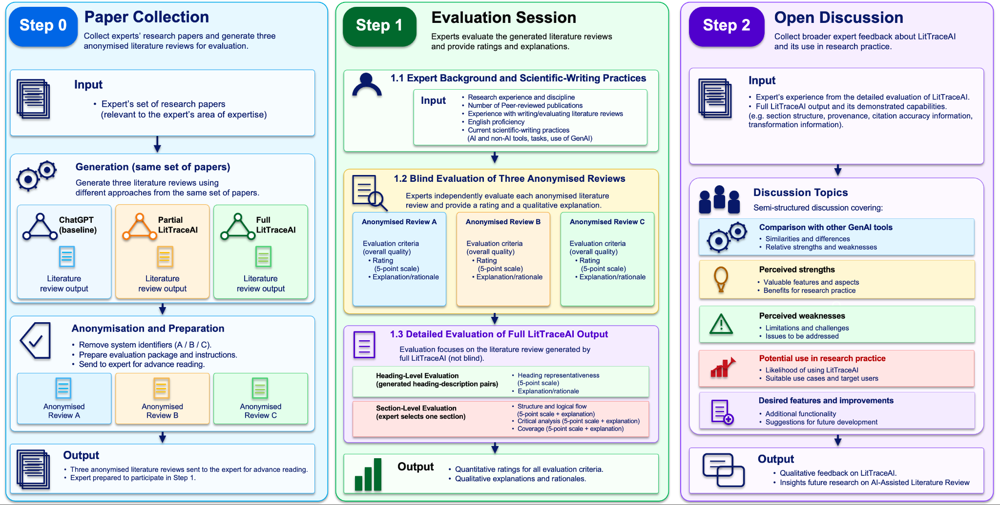
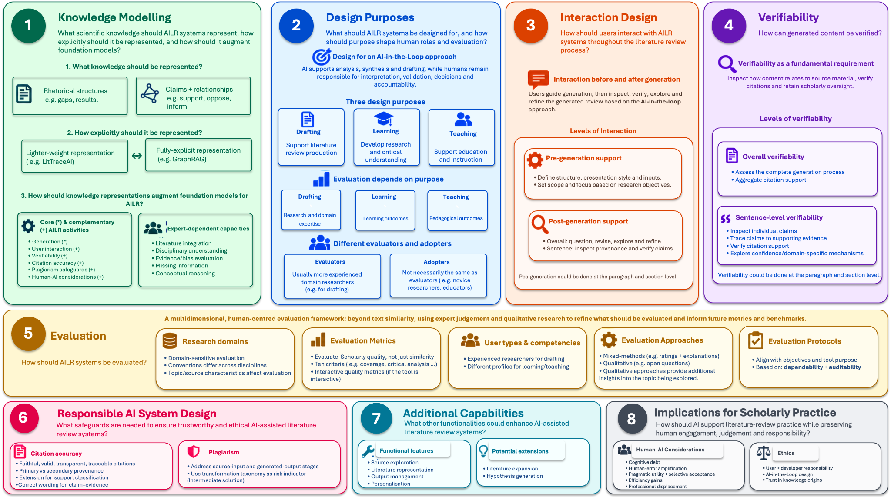

# A Research Agenda for AI-Assisted Literature Reviews

This repository presents a research agenda for AI-assisted literature review (AILR), informed by an expert evaluation of **LitTraceAI** (Literature Traceability using Artificial Intelligence). LitTraceAI drafts literature review sections from researcher-selected papers and lets researchers inspect the evidence behind generated claims. [Explore the LitTraceAI implementation](https://github.com/fcobolanos/LitTraceAI_Implementation/tree/main).

## 📖 Overview

The study combined expert ratings and qualitative explanations to examine how different AI-assisted approaches performed, what experts considered a high-quality literature review, and how LitTraceAI could support scholarly work. **Twenty-six experienced researchers contributed 27 evaluations**, each working with papers from an established area of expertise. Ratings were analysed descriptively and explanations were examined using reflexive thematic analysis.

## 🔄 Expert Evaluation Protocol

The protocol used a **convergent mixed-methods design**, combining quantitative ratings with qualitative rationales and open-ended responses. Ratings were analysed descriptively, and reflexive thematic analysis was used to examine experts’ rationales and discussion responses. Step 0 took place before the live session. Experts took about 60 minutes on average to read the three reviews in the pilot. Steps 1 and 2 took place live online and averaged 133.3 minutes combined (about 94 minutes for the evaluation and 39.4 minutes for the open discussion).

### Step 0 · Paper Collection

Each expert supplied papers from their research area. The same papers were used to generate three reviews: ChatGPT (baseline), partial LitTraceAI (without sentence-level rhetorical roles), and full LitTraceAI (with those roles).

The three outputs were labelled A, B, and C and sent to the expert for advance reading.

### Step 1 · Evaluation Session

The background questions and blind evaluation averaged **58.6 minutes combined**. The detailed evaluation averaged **35.3 minutes**.

**1.1 Expert Background and Scientific-Writing Practices.** Experts reported their research experience, discipline, peer-reviewed publication record, familiarity with writing or evaluating literature reviews, and English reading and writing proficiency. Open-ended questions asked which AI and non-AI tools they used for scientific writing and which tasks they used generative AI for, such as drafting, translation, and editing.

**1.2 Blind Evaluation of Three Anonymised Reviews.** Experts assessed each review independently against the standard of a high-quality literature review section written by a skilled researcher. They rated its overall quality on a five-point scale from Very Poor to Excellent and explained each rating. System identities and evidence-inspection features were hidden so experts could focus on the text.

**1.3 Detailed Evaluation of Full LitTraceAI Output.** Experts knew they were evaluating the full pipeline and used the interactive interface, which showed sentence-level provenance, citation-support assessments, and how source material had been transformed. They rated each generated heading–description pair for representativeness on a five-point scale, explained their ratings, and suggested any missing subtopics. Each expert then chose one representative or particularly relevant section and rated its structure and logical flow, critical analysis, and coverage, with an explanation for each rating.

### Step 2 · Open Discussion

A semi-structured discussion explored LitTraceAI’s strengths, limitations, potential uses, and opportunities for improvement.

## 💬 Qualitative Findings

### Step 0 · Participant Profile and Scientific-Writing Practices

The 26 participants came from social and behavioural sciences (15), STEM (6), and health and life sciences (5). They averaged 17 years of research experience, had each published at least 10 peer-reviewed papers, and reported extensive experience writing or evaluating literature reviews. All reported advanced or native English proficiency and evaluated a topic within an established research area.

General-purpose generative AI, reference managers, and writing tools were the most commonly reported tool categories. Participants mainly used generative AI for language support, especially improving writing style (84.6%), checking grammar and spelling (80.8%), and translating text (73.1%). Fewer reported using it to generate literature reviews (42.3%). The profile provides context for the evaluation. The writing-practice responses were collected in Step 1.1.

### Step 1 · Blind Evaluation

Experts’ rationales informed ten quality criteria.

| Quality criterion | What it assesses |
| --- | --- |
| Coverage | Whether the review addresses relevant studies, themes, and perspectives. |
| Citation accuracy | Whether citations correctly identify sources and support the claims they accompany. |
| Citation distribution | Whether citations are placed where support is needed and draw appropriately on relevant sources. |
| Crosschecking | Whether the review compares evidence across studies and identifies agreement or disagreement. |
| Critical analysis | Whether the review interprets findings, limitations, and gaps across studies. |
| Logical flow | Whether ideas and paragraphs connect coherently. |
| Logical structure | Whether headings and sections organise the material into a coherent whole. |
| Academic language usage | Whether the review uses vocabulary and conventions appropriate to scholarly writing. |
| Language quality | Whether the writing is clear, readable, and grammatically sound. |
| Narrative tone | Whether the prose maintains a consistent tone suited to a scholarly review. |

**Implicit evaluation criteria identified in expert judgements (Table 6.6)**

| Aspect | How it shaped expert judgement |
| --- | --- |
| Pragmatic utility | A draft could be valuable as a starting point even when it fell short of scholarly standards. |
| Critical trade-off in judgement | Experts weighed practical usefulness alongside academic quality. |
| Amplification of human error | A strong pipeline could carry inaccuracies from the source material into the review. |
| Selective acceptance | Experts kept, adapted, or discarded generated themes and insights according to their relevance and research priorities. |
| Verifiability over factuality | Traceability let experts inspect the evidence behind claims and verify them against the literature. |

### Step 1 · Detailed Evaluation

Experts judged whether the heading descriptions accurately and comprehensively reflected the source material. They also considered thematic depth and academic language. Their explanations for structure and logical flow, critical analysis, and coverage offered less detail about how they interpreted those criteria.

**Factors influencing expert evaluations of LitTraceAI heading descriptions (Table 7.5)**

| Factor | How it influenced evaluation |
| --- | --- |
| Efficiency gains | Experts valued useful descriptions that saved time and effort. |
| Reliance on background sections | Using background sections could omit relevant information elsewhere in the papers. |
| Limitations in information availability | The available sources sometimes lacked the information needed for a complete or accurate description. |
| Limitations in inferential reasoning | The tool could miss relationships that the papers implied without stating directly. |
| Scope limitations of the paper set | A narrow paper set could capture only part of the topic. |
| Paper selection error | Papers irrelevant to the intended topic could distort the description. |
| Broader disciplinary expectations | A description could represent the selected papers accurately while covering only part of the discipline’s understanding of the topic. |
| Pragmatic utility | A description could still be useful for its intended purpose despite gaps. |
| Selective acceptance | Experts could choose to leave out an evidence-supported point if it was peripheral to their review. |

**Step 2 · Open discussion.** Experts valued tracing claims to supporting evidence, organising papers by theme, and using drafts as a starting point for synthesis, writing, and research training. They wanted more control over generation and revision, better access to source material, stronger citation and plagiarism checks, and richer comparisons across studies. They also raised concerns about cognitive debt, amplification of errors in the literature, and scholarly responsibility.

## 🧭 Research Agenda

The research agenda draws on the LitTraceAI expert evaluation and the broader literature to identify eight directions for designing, evaluating, and using AI-assisted literature review tools. It centres on an **AI-in-the-Loop** approach in which AI supports organisation, synthesis, and drafting, while researchers retain responsibility for interpretation, verification, and scholarly decisions.

| Research area | Focus |
| --- | --- |
| Knowledge modelling | Represent rhetorical roles, claims, and relationships among studies so models can organise evidence and support synthesis. |
| Design purposes | Design for drafting, learning, or teaching and align evaluation with the intended purpose. |
| Interaction design | Let researchers guide scope and structure before generation and inspect, question, and refine drafts afterwards. |
| Verifiability | Let researchers inspect the generation process and trace individual claims to supporting evidence. |
| Evaluation | Use domain-sensitive criteria, expert judgement, and qualitative evidence alongside quantitative measures. |
| Responsible AI system design | Improve citation accuracy and provenance and address plagiarism risks in source inputs and generated outputs. |
| Additional capabilities | Explore source navigation, output management, personalisation, literature expansion, and hypothesis generation. |
| Implications for scholarly practice | Study effects on critical engagement, error amplification, accountability, and research work. |

[Download the design guidance checklist](./Guidance%20Resources/Checklist_Guidance_for_AI-Assisted_Literature_Review_Tools.xlsx).

## 📂 Repository Materials

- [Appendices](./Appendices) contain supporting analyses of expert ratings, heading representativeness, and open discussion themes.
- [Guidance Resources](./Guidance%20Resources) contains the design guidance checklist.
- [Code](./Code), [Data](./Data), and [Results](./Results) are currently placeholders.
